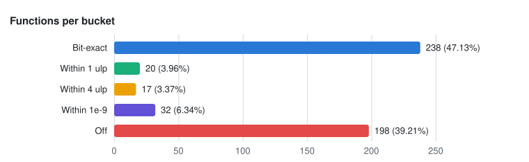
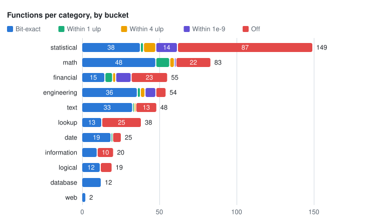
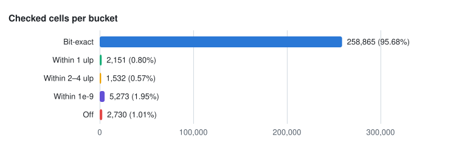

<!-- Generated by `make eval && make parity-report` (tools/src/rustsheet_tools/parity_report.py). Do not edit. -->
# RustSheet Excel parity

Per-function parity with Microsoft 365 Excel, from the eval run of **2026-10-19** on `main` at
**`c30e2d40`**.

Of **505** implemented functions with Excel-checked cells, **238** (47.13%) match Excel bit for bit on every checked cell, and **69** more are never further than 1e-9 relative (20 within 1 ulp, 17 within 4 ulp, 32 within 1e-9). **198** have at least one cell that is off, but 45 of those still match bit for bit on 99% or more of their cells. Across all **270,551** checked cells (a cell calling several functions counts for each), 95.68% are bit-exact and 1.01% are off.

The catalog has 506 in-scope functions; 1 has no scored cell yet (INFO). The full per-function table is in [parity/functions.md](parity/functions.md).

## Summary

### Functions per bucket

| Bucket | Functions | Share |
| --- | ---: | ---: |
| Bit-exact | 238 | 47.13% |
| Within 1 ulp | 20 | 3.96% |
| Within 4 ulp | 17 | 3.37% |
| Within 1e-9 | 32 | 6.34% |
| Off | 198 | 39.21% |
| **All** | **505** |  |

### Checked cells per bucket

| Bucket | Checked cells | Share |
| --- | ---: | ---: |
| Bit-exact | 258,865 | 95.68% |
| Within 1 ulp | 2,151 | 0.80% |
| Within 4 ulp | 1,532 | 0.57% |
| Within 1e-9 | 5,273 | 1.95% |
| Off | 2,730 | 1.01% |
| **All** | **270,551** |  |

## Charts







## By category

Each function counts once, in the bucket of its worst checked cell.

| Category | Functions | Bit-exact | Within 1 ulp | Within 4 ulp | Within 1e-9 | Off | Cells | Cells bit-exact |
| --- | ---: | ---: | ---: | ---: | ---: | ---: | ---: | ---: |
| statistical | 149 | 38 | 2 | 8 | 14 | 87 | 32,442 | 78.69% |
| math | 83 | 48 | 9 | 3 | 1 | 22 | 103,001 | 99.52% |
| financial | 55 | 15 | 5 | 2 | 10 | 23 | 9,522 | 75.46% |
| engineering | 54 | 36 | 2 | 3 | 7 | 6 | 37,391 | 98.82% |
| text | 48 | 33 | 1 | 1 | 0 | 13 | 18,960 | 96.92% |
| lookup | 38 | 13 | 0 | 0 | 0 | 25 | 31,549 | 98.49% |
| date | 25 | 19 | 1 | 0 | 0 | 5 | 8,577 | 97.03% |
| information | 20 | 10 | 0 | 0 | 0 | 10 | 8,100 | 99.14% |
| logical | 19 | 12 | 0 | 0 | 0 | 7 | 20,143 | 99.43% |
| database | 12 | 12 | 0 | 0 | 0 | 0 | 776 | 100.00% |
| web | 2 | 2 | 0 | 0 | 0 | 0 | 90 | 100.00% |

## Suites

The eval suites the counts come from. Suite cells include cells that call no catalog function;
"Within 4 ulp" is the harness's `numeric_ulp` verdict, and bit-exact leaves out accepted
deviations.

| Suite | Cases | Cells | Bit-exact | Within 4 ulp | Within 1e-9 | Off | Deviations | Unsupported |
| --- | ---: | ---: | ---: | ---: | ---: | ---: | ---: | ---: |
| fixtures | 17 | 248 | 96.37% | 0 | 0 | 9 | 0 | 0 |
| gen-m1 | 15 | 3,750 | 100.00% | 0 | 0 | 0 | 0 | 0 |
| gen-m10 | 20 | 1,690 | 93.08% | 0 | 0 | 117 | 0 | 0 |
| gen-m2 | 30 | 12,000 | 100.00% | 0 | 0 | 0 | 0 | 0 |
| gen-m5 | 10 | 400 | 99.25% | 2 | 0 | 1 | 0 | 0 |
| gen-m6 | 25 | 1,000 | 99.90% | 1 | 0 | 0 | 0 | 0 |
| gen-m7 | 25 | 994 | 99.80% | 0 | 0 | 2 | 0 | 0 |
| gen-m8a | 12 | 3,577 | 83.20% | 0 | 0 | 601 | 0 | 0 |
| gen-m8b | 9 | 3,368 | 91.78% | 0 | 0 | 277 | 0 | 0 |
| gen-m9 | 25 | 998 | 98.00% | 0 | 2 | 18 | 0 | 0 |
| ironcalc-calc | 219 | 72,223 | 98.45% | 520 | 539 | 58 | 0 | 0 |
| poi | 336 | 27,290 | 98.29% | 16 | 22 | 425 | 0 | 3 |
| probes | 1,019 | 66,978 | 97.30% | 380 | 546 | 879 | 4 | 0 |
| probes-numeric | 153 | 80,719 | 91.33% | 2,597 | 3,786 | 617 | 0 | 0 |
| smoke | 6 | 46 | 100.00% | 0 | 0 | 0 | 0 | 0 |

## How to read this

- **Bit-exact**: the same value and type as Excel. Accepted deviations (decision 0036) count here.
- **Within 1 ulp** / **Within 4 ulp**: a number at most 1, or 2 to 4, units in the last place of a
  64-bit double from Excel's.
- **Within 1e-9**: a number within 1e-9 relative error of Excel's.
- **Off**: anything further, or a wrong type, error or text.
- A function is placed by its **worst** checked cell: one off cell makes the function off.
  45 of the 198 off functions still match bit for bit on 99% or
  more of their cells.
- A cell that calls several functions counts for each of them, as the eval report's per-function
  counts do (`functions_in` in crates/rustsheet-eval/src/report.rs).
- Only catalog functions with `scope: in` (eval/catalog/scope.json) are counted. Cells the engine
  reports as unsupported are left out.

## Regenerate

```
make eval && make parity-report
```

`make parity-report` takes `COMMIT=` and `RUN_DATE=` to name a snapshot; they default to the
checked-out commit and the report file's date.
