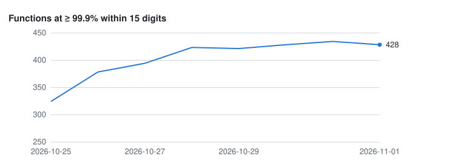
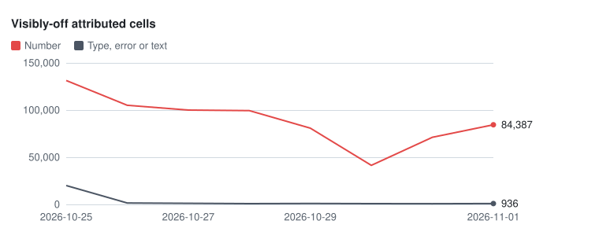
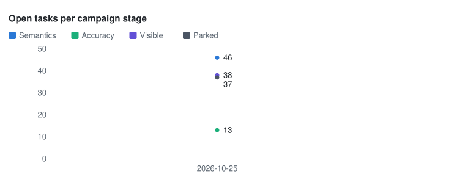
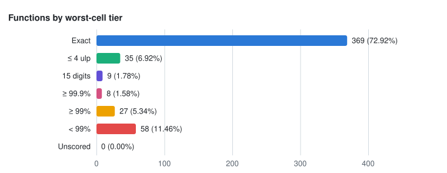
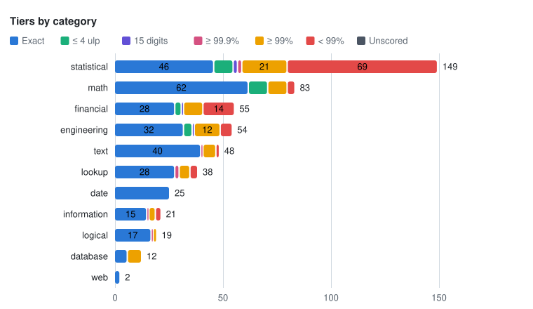
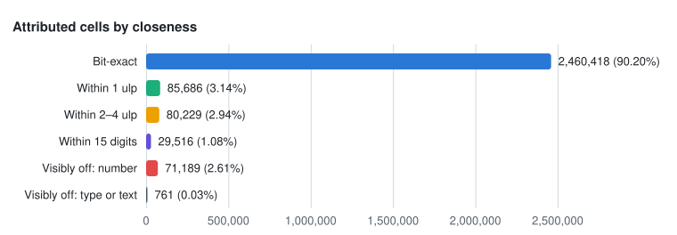
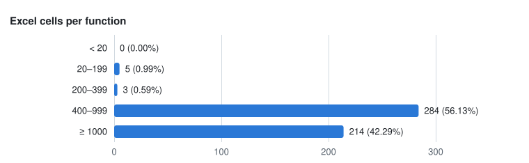

<!-- Generated by `make eval && make progress-report` (tools/src/rustsheet_tools/progress_report/). Edit only the text inside the judgment blocks. -->
# RustSheet progress

<!-- progress:generated status -->
The eval run of **2026-10-29** at commit `0763db13` (report.json `run`).

- **Suites run (17):** calipers, corpus-bench, fixtures, gen-m1, gen-m10, gen-m2, gen-m5, gen-m6, gen-m7, gen-m8a, gen-m8b, gen-m9, ironcalc-calc, poi, probes, probes-numeric, smoke.
- **Suites skipped (0):** none.
- The steward's operational log is [docs/status.md](status.md). Every function's parity is in
  [docs/progress/functions.md](progress/functions.md).
<!-- /progress:generated -->

## Bottom line

<!-- progress:judgment bottom-line -->
<!-- as-of: 2026-10-29 0763db13 -->
Values still match Excel on real workbooks, and today's merges cut the visibly-off numbers sharply. Phase 1 has not exited, and new probes keep the M2, M6 and M9 exits open.

- **Phase 1 has not exited.** 421 of 506 in-scope functions meet the exit rate (decision 0118). The M1, M5 and M11 exit rows are met; M5 is newly met.
- **Numbers improved; the tiers did not.** Visibly-off numbers fell by −18,593 to 80,846 since the last complete run, while visibly-off type, error or text cells rose by +120 to 976 and attributed Excel cells grew by +6,104. Phase 1 functions moved −2 and the Exact tier −6. Judgment: new probes are finding off cells faster than the semantics fixes close them. Tasks done moved +94.
- **Real-world files are close.** On calipers, 99.88% of cells are bit-exact and 161 of its 173 workbooks have every cell within 15 digits. Corpus-bench has a visibly-off cell in 1 of 320 workbooks and poi in 3 of 115. Of the real-world calls to attributed functions, 99.97% land within 15 digits.
- **The biggest gap is still numeric accuracy** (judgment). The 85 functions below the rate hold 80,729 visibly-off numbers and 945 type, error or text cells. Fixing only the latter would lift 14 of them, and 2 semantics tasks are ready.
- **M2's probe exit moved further away, from new coverage, not regressions.** The M0-M2 probes show 344 visibly-off cells and 352 known failures. Nearly all come from one new probe of criteria operands read with VALUE's grammar (owner T-3151, in review); the rest are T-3097's paren-depth cases (owner T-3165, filed this run).
<!-- /progress:judgment -->

<!-- progress:generated goals -->
## Goals

**Phase 1 \(decision 0114\): not met \(421/506 functions covered with ≥ 99.9% of their attributed cells within 15 digits, decision 0118\)**

**Fifteen-digit parity: not met \(coverage 506/506, visibly-off cells 83213\)** At the previous complete run, **2026-10-28** at commit `180c8194`, the checkpoint was not met.

Milestones whose exit row in the report is met: M1, M5, M11.

### Milestones

One row per milestone of [docs/milestones.md](milestones.md), in milestone order; the phase
table there gives the order they are worked in. "Exit criteria checked" counts the `- [x]` items
of the milestone's exit criteria ("prose" when they are not a checklist). Catalog coverage, the
exit measures (decision 0085, read at visible parity by decision 0114), the frozen probe lists
(decision 0043) and the probe milestones (decision 0051) are the eval report's rows; a probe row
such as M0–M2 is shown on each milestone it covers. Tasks are `scripts/tasks.py stats --json`.

| Milestone | Phase | Exit criteria checked | Catalog coverage | Exit measures (report) | Frozen list and probes | Todo | In progress | Blocked | Done |
| --- | --- | --- | --- | --- | --- | ---: | ---: | ---: | ---: |
| M0 Scaffolding, harness, oracle, autonomous loop | 1 | 5/5 | – | – | probes M0-M2: 344 visibly off, 352 known failures | 0 | 0 | 0 | 98 |
| M1 Core calculation semantics (no functions beyond trivial) | 1 | prose | – | **exit met**; coverage ?/? (not in run); generated suite 0 visibly off of 3,750, allowance 0 (met); smoke 0 visibly off of 46, allowance 0 (met); ironcalc-calc ? visibly off (not in run); probes 0 visibly off (met) | frozen list m1-probes: 0 known failures in 0 cases (89 of 89 run); probes M0-M2: 344 visibly off, 352 known failures | 4 | 1 | 2 | 391 |
| M2 Top functions (the everyday spreadsheet) | 1 | prose | 37/37 | **exit not met**; coverage 37/37 (not required); generated suite 0 visibly off of 16,280, allowance 0 (met); ironcalc-calc 0 visibly off (met); probes 344 visibly off (not met) | probes M0-M2: 344 visibly off, 352 known failures | 43 | 0 | 2 | 451 |
| M3 Dependency graph, incremental and lazy recalculation (Phase 2) | 2 | prose | – | – | probes M3: 0 visibly off, 0 known failures | 6 | 0 | 4 | 11 |
| M4 Storage, memory and structural edits (Phase 2) | 2 | prose | – | – | – | 0 | 0 | 0 | 0 |
| M5 Function families I: math, logical, text, information | 1 | prose | 135/135 | **exit met**; coverage 135/135 (met); generated suite 0 visibly off of 41,640, allowance 41 (met); ironcalc-calc 0 visibly off (met); probes 0 visibly off (met) | probes M5: 0 visibly off, 0 known failures | 19 | 0 | 0 | 237 |
| M6 Lookup & reference, date & time | 1 | prose | 39/39 | **exit not met**; coverage 39/39 (met); generated suite 0 visibly off of 25,240, allowance 25 (met); ironcalc-calc 0 visibly off (met); probes 337 visibly off (not met) | probes M6: 337 visibly off, 337 known failures | 15 | 0 | 0 | 102 |
| M7 Dynamic arrays & modern Excel | 1 | prose | 32/32 | **exit not met**; coverage 32/32 (not required); generated suite 0 visibly off of 36,685, allowance 36 (met); ironcalc-calc 0 visibly off (not required); probes 60 visibly off (not met); spill extents 0 failures (met) | probes M7: 60 visibly off, 69 known failures | 33 | 0 | 0 | 198 |
| M8 Names, tables, structured references, multi-sheet | 1 | prose | no functions | **exit not met**; coverage ?/? (not in run); gen-m8a 0 visibly off of 3,577, allowance 0 (met); gen-m8b 0 visibly off of 3,368, allowance 0 (met); poi M8 subset 0 visibly off of 4,084, allowance 20 (met); ironcalc-calc ? visibly off (not in run); probes 45 visibly off (not met) | probes M8: 45 visibly off, 45 known failures | 19 | 0 | 0 | 51 |
| M9 Numerical parity: statistical, financial, engineering, database | 1 | prose | 263/263 | **exit not met**; coverage 263/263 (not required); no suite required; ironcalc-calc 120 visibly off of 73,198, allowance 36 (not met); probes 863 visibly off (not met); functions at the Phase 1 rate 75 below of 263 (not met) | probes M9: 863 visibly off, 2,894 known failures | 193 | 1 | 9 | 480 |
| M10 Formatting & display | 1 | prose | no functions | **exit not met**; coverage ?/? (not in run); generated suite 0 visibly off of 1,690, allowance 0 (not met); generated suite text 61 failing of 10,400; ironcalc-calc ? visibly off (not in run); probes 25 visibly off, text 0 failing of 421 (not met) | probes M10: 25 visibly off, 25 known failures | 23 | 0 | 0 | 48 |
| M11 Real-world fidelity | 1 | prose | no functions | **exit met**; coverage ?/? (not in run); corpus-bench 6 visibly off of 205,366, allowance 410 (met); ironcalc-calc ? visibly off (not in run); probes 0 visibly off (met) | probes M11: 0 visibly off, 0 known failures | 21 | 0 | 1 | 55 |
| M12 API v1, bindings & release | 3 | prose | – | – | – | 12 | 0 | 0 | 1 |
| M13 Performance at scale (Phase 2) | 2 | prose | – | – | – | 0 | 0 | 1 | 1 |
| M14 Desktop-oracle parity (Phase 4) | 4 | prose | – | – | – | 3 | 0 | 19 | 0 |
<!-- /progress:generated -->

<!-- progress:generated campaign -->
## Campaign stages

Decision 0114 works the visibly-off cells in stages, picked in this order: semantics, then
accuracy, then visible. **85** in-scope functions are below the Phase 1 rate
(≥ 99.9% of their counted cells within 15 digits; tiers ≥ 99% and < 99%). Their attributed Excel cells hold
**945** visibly-off type, error or text cells and **80,729** visibly-off numbers.
Fixing only the type, error and text cells would lift **14** of them to ≥ 99.9%.

| Stage | Fixes | Open | Ready | Blocked | Done | Visibly-off cells (functions under 99.9%) | Functions lifted to ≥ 99.9% |
| --- | --- | ---: | ---: | ---: | ---: | ---: | ---: |
| Semantics | wrong type, error or text, and semantic rules | 2 | 2 | 0 | 111 | 945 type, error or text | 14 of 85 |
| Accuracy | more accurate kernels where Excel is close to correctly rounded | 15 | 12 | 0 | 12 | 80,729 numbers, accuracy and visible together | – |
| Visible | Excel's own algorithm where Excel is the inaccurate one (time-boxed) | 42 | 28 | 7 | 250 | in the accuracy row | – |
| Parked (defer: phase-1b) | last-digit work on cells already within 15 digits (Phase 1b) | 44 | 0 | 6 | 1 | – | – |

- **Tasks** are `scripts/tasks.py stats --json`. Open is todo, in progress or blocked. Ready is
  the tasks ready on `main`, ignoring branch claims, so a claimed task still counts. A task with a
  stage and `defer: phase-1b` counts in its stage row and in the parked row (decision 0119), so the
  rows do not add up to a total.
- **Visibly-off cells** are the attributed cells of the functions below the rate. Numbers are
  shown for the accuracy and visible stages together: telling them apart needs a high-precision
  reference and per-family judgment, which a daily run cannot repeat (SPEC-0022, "Alternatives
  considered").
- **Lifted by the semantic fixes alone:** CELL, FORECAST.ETS, FORECAST.ETS.CONFINT, FORECAST.ETS.SEASONALITY, FORECAST.ETS.STAT, FORMULATEXT, FVSCHEDULE, IMABS, IMSQRT, IMTAN, INFO, SMALL, VALUE, XNPV.
<!-- /progress:generated -->

<!-- progress:generated since-last-run -->
## Since the last run

Against the last complete run, **2026-10-28** at commit `180c8194` ([docs/progress/history.json](progress/history.json)). Git could not count the commits since then.

| Measure | 2026-10-28 | 2026-10-29 | Change |
| --- | ---: | ---: | ---: |
| Phase 1: functions at ≥ 99.9% within 15 digits | 423 | 421 | −2 |
| Functions in tier: Exact | 371 | 365 | −6 |
| Functions in tier: ≤ 4 ulp | 29 | 32 | +3 |
| Functions in tier: 15 digits | 10 | 9 | −1 |
| Functions in tier: ≥ 99.9% | 4 | 6 | +2 |
| Functions in tier: ≥ 99% | 28 | 26 | −2 |
| Functions in tier: &lt; 99% | 64 | 68 | +4 |
| Functions in tier: Unscored | 0 | 0 | 0 |
| Visibly-off attributed cells: number | 99,439 | 80,846 | −18,593 |
| Visibly-off attributed cells: type, error or text | 856 | 976 | +120 |
| Attributed Excel cells | 1,494,473 | 1,500,577 | +6,104 |
| Tasks done | 2,030 | 2,124 | +94 |
<!-- /progress:generated -->

<!-- progress:generated trends -->
## Trends

One point per complete run in [docs/progress/history.json](progress/history.json).
A date with no complete run (a missed or stale day) leaves a gap in the lines; nothing is
interpolated.

<!-- /progress:generated -->

<!-- progress:generated parity -->
## Parity

**Phase 1 (decision 0114): not met.** **421 of 506** in-scope functions are covered with ≥ 99.9% of their attributed Excel cells within 15 digits (decision 0118; report.json `v15_checkpoint`).

_Information, gates nothing:_ 141 of 506 functions are covered with ≥ 99.9% of every Excel cell that calls them within 15 digits, each visibly-off cell blamed on every non-glue function of its formula (decision 0088).

Real-world calls: **99.97%** of the 1,373,918 calls to attributed in-scope functions in the calipers and poi formula cells land within 15 digits, weighting each function's attributed within-15-digit share by its calls (report.json `functions[].real_world_calls`).

Each in-scope function is placed by the **worst** of its counted Excel cells, so one off cell
drops it a tier. A cell counts toward a function only when that function is its formula's only
call outside the glue list (IF, SUM, INDEX and the like); a function with fewer than 20 such
cells is placed by every Excel cell that calls it. "Within 15 digits" means Excel's displayed
value is the same. Every function is listed in [docs/progress/functions.md](progress/functions.md).

### Functions by worst-cell tier

**406 of 506** in-scope functions (80.24%) never differ from Excel in the 15 digits Excel shows, on every counted cell; **68** have fewer than 99% of their cells within 15 digits. The Phase 1 line above counts a function once 99.9% of its cells match; this stricter figure counts only functions with no cell off at all.

| Tier | Meaning | Functions | Share | Placed by every Excel cell |
| --- | --- | ---: | ---: | ---: |
| Exact | every cell bit-exact | 365 | 72.13% | 3 |
| ≤ 4 ulp | every cell within 4 ulp | 32 | 6.32% | 0 |
| 15 digits | every cell within 15 significant digits | 9 | 1.78% | 0 |
| ≥ 99.9% | ≥ 99.9% of cells within 15 digits | 6 | 1.19% | 0 |
| ≥ 99% | 99–99.9% of cells within 15 digits | 26 | 5.14% | 0 |
| &lt; 99% | &lt; 99% of cells within 15 digits | 68 | 13.44% | 0 |
| Unscored | no scored Excel cell | 0 | 0.00% | 0 |
| **All** |  | **506** |  | 3 |

### Tiers by category

| Category | Functions | Exact | ≤ 4 ulp | 15 digits | ≥ 99.9% | ≥ 99% | &lt; 99% | Unscored |
| --- | ---: | ---: | ---: | ---: | ---: | ---: | ---: | ---: |
| statistical | 149 | 66 | 17 | 6 | 1 | 11 | 48 | 0 |
| math | 83 | 66 | 7 | 0 | 3 | 5 | 2 | 0 |
| financial | 55 | 34 | 4 | 1 | 1 | 5 | 10 | 0 |
| engineering | 54 | 45 | 4 | 2 | 0 | 2 | 1 | 0 |
| text | 48 | 45 | 0 | 0 | 1 | 2 | 0 | 0 |
| lookup | 38 | 35 | 0 | 0 | 0 | 0 | 3 | 0 |
| date | 25 | 25 | 0 | 0 | 0 | 0 | 0 | 0 |
| information | 21 | 19 | 0 | 0 | 0 | 0 | 2 | 0 |
| logical | 19 | 17 | 0 | 0 | 0 | 1 | 1 | 0 |
| database | 12 | 11 | 0 | 0 | 0 | 0 | 1 | 0 |
| web | 2 | 2 | 0 | 0 | 0 | 0 | 0 | 0 |

### Attributed cells by closeness

**1,500,577** attributed Excel cells: 83.17% bit-exact, 94.55% within 15 digits, **81,822** (5.45%) visibly off.

| Closeness | Attributed cells | Share |
| --- | ---: | ---: |
| Bit-exact | 1,248,075 | 83.17% |
| Within 1 ulp | 69,409 | 4.63% |
| Within 2–4 ulp | 67,778 | 4.52% |
| Within 15 digits | 33,493 | 2.23% |
| Visibly off: number | 80,846 | 5.39% |
| Visibly off: type or text | 976 | 0.07% |
| **All** | **1,500,577** |  |

### Suites

Every cell each suite scored. Bit-exact and ≤ 4 ulp leave out accepted deviations (decision
0036). Visibly off and the workbook columns count in-scope cells; a workbook is a case with a
scored in-scope cell. Known failures are the `F` lines of eval/baseline/&lt;suite&gt;.txt, with the
displayed-text (`TF`) lines after "text".

| Suite | Cases | Cells | Bit-exact | ≤ 4 ulp | Visibly off | Workbooks | All exact | All within 15 digits | Any visibly off | Timeouts | Known failures |
| --- | ---: | ---: | ---: | ---: | ---: | ---: | ---: | ---: | ---: | ---: | ---: |
| calipers | 456 | 1,621,891 | 99.88% | 99.98% | 209 | 173 | 143 | 161 | 12 | 0 | 3,461 |
| corpus-bench | 912 | 205,366 | 99.99% | 99.99% | 6 | 320 | 318 | 319 | 1 | 0 | 3 |
| fixtures | 25 | 348 | 100.00% | 100.00% | 0 | 25 | 25 | 25 | 0 | 0 | 0 |
| gen-m1 | 15 | 3,750 | 100.00% | 100.00% | 0 | 15 | 15 | 15 | 0 | 0 | 0 |
| gen-m10 | 20 | 1,690 | 100.00% | 100.00% | 0 | 20 | 20 | 20 | 0 | 0 | 0; text 61 |
| gen-m2 | 43 | 16,280 | 100.00% | 100.00% | 0 | 43 | 43 | 43 | 0 | 0 | 0 |
| gen-m5 | 115 | 41,640 | 99.99% | 100.00% | 0 | 115 | 114 | 115 | 0 | 0 | 1 |
| gen-m6 | 91 | 25,240 | 100.00% | 100.00% | 0 | 91 | 91 | 91 | 0 | 0 | 0 |
| gen-m7 | 55 | 36,685 | 100.00% | 100.00% | 0 | 55 | 55 | 55 | 0 | 0 | 0 |
| gen-m8a | 12 | 3,577 | 100.00% | 100.00% | 0 | 12 | 12 | 12 | 0 | 0 | 0 |
| gen-m8b | 9 | 3,368 | 100.00% | 100.00% | 0 | 9 | 9 | 9 | 0 | 0 | 0 |
| gen-m9 | 264 | 96,483 | 96.57% | 98.00% | 1,717 | 264 | 46 | 50 | 214 | 0 | 3,311 |
| ironcalc-calc | 224 | 73,203 | 99.25% | 99.78% | 120 | 223 | 196 | 208 | 15 | 0 | 552 |
| poi | 336 | 27,209 | 99.62% | 99.64% | 95 | 115 | 112 | 112 | 3 | 0 | 117 |
| probes | 1,897 | 133,185 | 97.21% | 98.59% | 1,674 | 1,879 | 1,754 | 1,802 | 77 | 0 | 3,722 |
| probes-numeric | 271 | 616,240 | 60.09% | 81.74% | 79,392 | 271 | 80 | 130 | 141 | 0 | no baseline |
| smoke | 6 | 46 | 100.00% | 100.00% | 0 | 6 | 6 | 6 | 0 | 0 | 0 |
<!-- /progress:generated -->

<!-- progress:generated top-functions -->
## The 40 most-used functions

The 40 in-scope functions with the highest real-world frequency `prior` in
eval/catalog/functions.yaml, ties by name. These are the bulk of what everyday workbooks call.
**32 of 40** never differ from Excel in the 15 digits Excel shows, on every counted
cell; **37** meet the Phase 1 rate (≥ 99.9% within 15 digits, and covered). The columns
are those of [docs/progress/functions.md](progress/functions.md); Excel cells counts every
Excel-evidence cell that calls the function, accepted deviations included; real-world calls
counts the calipers and poi formula cells that call it (T-0079).

| # | Function | Category | Tier | Prior | Attributed cells | Within 15 digits | Excel cells | Real-world calls |
| --- | --- | --- | --- | ---: | ---: | ---: | ---: | ---: |
| 1 | SUM | math | ≥ 99.9% | 72 | 139,526 | 99.99% | 156,005 | 139,314 |
| 2 | IF | logical | Exact | 20 | 43,014 | 100.00% | 361,550 | 279,588 |
| 3 | AVERAGE | statistical | Exact | 10 | 15,734 | 100.00% | 18,904 | 15,014 |
| 4 | VLOOKUP | lookup | Exact | 8.5 | 33,212 | 100.00% | 43,397 | 7,732 |
| 5 | ROUND | math | Exact | 8 | 8,362 | 100.00% | 36,857 | 32,829 |
| 6 | MAX | statistical | Exact | 7 | 3,041 | 100.00% | 7,016 | 2,095 |
| 7 | COUNT | statistical | Exact | 6 | 855 | 100.00% | 3,559 | 97 |
| 8 | INDEX | lookup | Exact | 6 | 1,305 | 100.00% | 73,431 | 59,043 |
| 9 | MIN | statistical | ≤ 4 ulp | 6 | 1,937 | 100.00% | 5,555 | 1,078 |
| 10 | MATCH | lookup | Exact | 5 | 11,077 | 100.00% | 18,612 | 11,831 |
| 11 | COUNTIF | statistical | ≥ 99% | 4 | 6,532 | 99.20% | 9,064 | 179 |
| 12 | IFERROR | logical | Exact | 4 | 71,094 | 100.00% | 111,895 | 88,206 |
| 13 | SUBTOTAL | math | Exact | 4 | 690 | 100.00% | 2,484 | 69 |
| 14 | SUMIF | math | ≥ 99.9% | 4 | 97,333 | 99.90% | 99,211 | 95,352 |
| 15 | AND | logical | ≥ 99% | 3 | 496 | 100.00% | 7,621 | 4,506 |
| 16 | COUNTA | statistical | Exact | 3 | 860 | 100.00% | 2,787 | 157 |
| 17 | DATE | date | Exact | 3 | 1,494 | 100.00% | 40,687 | 22,688 |
| 18 | LEFT | text | Exact | 3 | 22,979 | 100.00% | 24,770 | 22,532 |
| 19 | OR | logical | Exact | 3 | 475 | 100.00% | 141,302 | 137,989 |
| 20 | RIGHT | text | Exact | 3 | 333 | 100.00% | 4,076 | 655 |
| 21 | SUMIFS | math | &lt; 99% | 3 | 4,572 | 97.88% | 13,621 | 8,730 |
| 22 | ABS | math | Exact | 2 | 41,413 | 100.00% | 50,190 | 48,230 |
| 23 | CONCATENATE | text | Exact | 2 | 21,800 | 100.00% | 24,289 | 23,019 |
| 24 | COUNTIFS | statistical | ≥ 99% | 2 | 38,047 | 99.88% | 45,244 | 5,378 |
| 25 | DAY | date | Exact | 2 | 390 | 100.00% | 2,241 | 271 |
| 26 | FILTER | lookup | Exact | 2 | 324 | 100.00% | 3,051 | 16 |
| 27 | INT | math | Exact | 2 | 492 | 100.00% | 1,684 | 59 |
| 28 | ISERROR | information | Exact | 2 | 12,903 | 100.00% | 14,894 | 12,201 |
| 29 | LEN | text | Exact | 2 | 563 | 100.00% | 2,891 | 59 |
| 30 | MID | text | Exact | 2 | 284 | 100.00% | 1,824 | 65 |
| 31 | MONTH | date | Exact | 2 | 469 | 100.00% | 28,553 | 22,662 |
| 32 | NOT | logical | Exact | 2 | 194 | 100.00% | 1,242 | 55 |
| 33 | OFFSET | lookup | Exact | 2 | 108,698 | 100.00% | 111,451 | 109,158 |
| 34 | ROUNDDOWN | math | Exact | 2 | 1,119 | 100.00% | 2,509 | 125 |
| 35 | ROUNDUP | math | Exact | 2 | 3,044 | 100.00% | 7,874 | 1,808 |
| 36 | SUMPRODUCT | math | ≥ 99.9% | 2 | 2,012 | 100.00% | 4,157 | 353 |
| 37 | TEXT | text | ≥ 99.9% | 2 | 33,439 | 99.93% | 38,359 | 24,820 |
| 38 | TRIM | text | Exact | 2 | 231 | 100.00% | 1,321 | 26 |
| 39 | YEAR | date | Exact | 2 | 36,084 | 100.00% | 64,163 | 55,001 |
| 40 | CHOOSE | lookup | Exact | 1.5 | 379 | 100.00% | 3,121 | 1,278 |
<!-- /progress:generated -->

<!-- progress:generated evidence -->
## Evidence depth

Excel cells are the scored cells whose expected value came from Excel itself (oracle values or
Excel-saved cached values) and whose formula calls the function (report.json
`v15_checkpoint.functions[].cells`). The evidence floor is 20 cells; the fifteen-digit
checkpoint (decision 0094) wants 400, 200 of them in a generated suite with
the function as the outer call.

The median in-scope function has **766.5** Excel cells. **506 of
506** (100.00%) are covered under decision 0094 (the report's `covered`: the two
bars, or 20 cells for a function the catalog exempts). **8** have fewer than
400 Excel cells, 0 of them fewer than 20: RAND (28), NOW (29), RANDARRAY (37), TODAY (37), RANDBETWEEN (99), INFO (234), TRUE (343), FALSE (345).

| Excel cells | Functions | Share |
| --- | ---: | ---: |
| &lt; 20 | 0 | 0.00% |
| 20–199 | 5 | 0.99% |
| 200–399 | 3 | 0.59% |
| 400–999 | 312 | 61.66% |
| ≥ 1000 | 186 | 36.76% |
| **All** | **506** |  |

<!-- /progress:generated -->

<!-- progress:generated arguments -->
## Argument coverage

Indicative, rule-based expected types. Each catalog parameter expects argument classes by its mode: a `range` parameter a reference; `lambda` and `name` parameters none (not counted); every other mode all eleven (positive number, zero, negative, fraction, numeric text, text, empty text, boolean, error, blank, range or array). A class is seen when an Excel-evidence cell passes it: a literal as written, a single-cell reference by the referenced cell's value; nested calls and operators are not classified (report.json `argument_coverage[]`).

Average single-argument coverage is **87.7%** (median 90.9%) over 499 functions; 7 have no counted parameter. The one-off assessment of 2026-10-25 measured 94% with its own classifier. Lowest: JIS (0%), LAMBDA (0%), INFO (18%), GETPIVOTDATA (35%), RANDARRAY (40%), FILTER (45%), PIVOTBY (49%), AVERAGEIFS (54%), MAXIFS (54%), MINIFS (54%).

Pairwise coverage counts, for each two counted parameters, the pairs of an expected class of each that one Excel-evidence call passes together. Average pairwise coverage is **32.6%** (median 25.3%) over 318 functions with two or more counted parameters; the one-off assessment of 2026-10-25 measured a 44% median.

| Coverage | Functions | Share |
| --- | ---: | ---: |
| &lt; 50% | 7 | 1.40% |
| 50–74% | 16 | 3.21% |
| 75–89% | 215 | 43.09% |
| 90–99% | 135 | 27.05% |
| 100% | 126 | 25.25% |
| **All** | **499** |  |
<!-- /progress:generated -->

<!-- progress:generated codebase -->
## Codebase health

Counts of the quality ratchets and knowledge files, with the change. Lower is better for the first four rows.

| Measure | Now | Change |
| --- | ---: | ---: |
| Lint-debt allow entries | 91 | n/a |
| Duplicated lines | 2,931 | n/a |
| Oversized files | 8 | n/a |
| Functions below the evidence floor | 0 | n/a |
| Decision records | 162 | n/a |
| Excel-semantics lines | 24,009 | n/a |
<!-- /progress:generated -->

## Real-world readiness

<!-- progress:judgment readiness -->
<!-- as-of: 2026-10-29 0763db13 -->
Ratings are the steward's judgment, grounded in the numbers they cite. The page measures computed values only, not speed or saving.

- **Read and compute: likely.** calipers matches Excel bit for bit on 99.88% of 1,621,891 cells, and 161 of its 173 workbooks have no cell off in the 15 digits Excel shows. Corpus-bench has a visibly-off cell in 1 of 320 workbooks.
- **Edit and recalc: likely.** The frozen M1 probe list for core calculation semantics has 0 known failures, with 89 of 89 cases run. The page does not measure recalculation after an edit.
- **Large ranges: partly.** No suite timed out on this run (0 timeouts in every suite). But the page does not measure recalculation time, and the dependency graph is Phase 2 work whose milestone row shows 4 blocked tasks. Judgment: large lookup or criteria ranges may be slow.
- **Save and round-trip: partly.** Not measured: none of the page's numbers comes from writing a file. This rating is judgment, based on the export and structural-edit work on tables that is still open; the M8 row shows 19 tasks to do.
<!-- /progress:judgment -->

## Risks

<!-- progress:judgment risks -->
<!-- as-of: 2026-10-29 0763db13 -->
1. **Statistical numerics.** 48 of 149 statistical functions have fewer than 99% of their cells within 15 digits. Judgment: most of the 80,846 visibly-off numbers sit here. Owner: T-2510 (incomplete beta, accuracy stage).
2. **Financial numerics.** 10 of 55 financial functions are below 99%, and the M9 probes show 863 visibly-off cells, led by bond, IRR and payment probes. Judgment: these are iterative fits whose last digits follow Excel's own algorithm, so this is slow, time-boxed work. Owner: T-2131 (IRR to 15 digits).
3. **Milestone exits wait on new probe cells.** The M0-M2 probes have 344 visibly-off cells and the M6 probes 337. Judgment: the generated suites of both milestones are met, so these cells are the cheapest exits on the page, and both are newly probed rules, not regressions. Owners: T-3151 (M2, criteria numbers read with VALUE's grammar), T-3165 (M2, paren-depth cases) and T-3132 (M6, XMATCH and XLOOKUP exact compares).
4. **Everyday functions still off.** TEXT, the 37th most-used function, has 99.93% of its 33,439 attributed cells within 15 digits, and SUM has 99.99%. Judgment: these functions appear in ordinary workbooks, so each visibly-off cell matters more than its count suggests. Owner: T-1925 (numeral-system digits in locale tags).
5. **Large ranges are unmeasured.** There were 0 timeouts on this run, but the page has no recalculation timing. Judgment: recalculation stays full until the dependency graph lands. Owner: T-0401 (blocked: Phase 2).
<!-- /progress:judgment -->

<!-- progress:generated method -->
## Method

- **Status.** The run date, commit and suites are the eval report's `run` record
  (eval/runs/latest/report.json, written by `make eval`): the UTC date, `git rev-parse --short=8
  HEAD`, and each suite under eval/suites that did not run, with the reason.
- **Judgment blocks.** The bottom line, readiness and risks are written by the steward between
  judgment markers. The generator copies their text unchanged on every run. Each starts with an
  as-of line naming the run it was written for; when that is not this run, a line under the
  heading says so, and the text is still shown.
- **One definition per measure.** Every verdict, bucket and tier is computed once, in the Rust eval
  report (crates/rustsheet-eval). This page only adds up the report's counts.
- **Goals.** The Phase 1 and checkpoint lines are report.json `v15_checkpoint.phase1_line`
  and `verdict_line`, as the eval wrote them; the previous run's checkpoint is the last complete
  row of docs/progress/history.json. The milestone rows read docs/milestones.md for the phase table
  and the exit checklists, report.json `catalog_coverage`, `milestone_exit`, `milestone_lists`
  and `probe_milestones`, and tasks.json `by_milestone`.
- **Campaign stages.** Task counts are tasks.json `by_campaign` and `deferred` (decision 0119).
  The functions below the rate are those whose report tier is under `rate999` and whose
  `meets_rate` is false (decision 0134 leaves listed cells out of the rate, not the tier); a function is
  lifted when its counted cells (`v15_checkpoint.functions[].rate_cells`) reach the report's rate
  (`rate_num / rate_den`) once its visibly-off type, error and text cells are fixed.
- **Parity.** Tiers, attribution and the Phase 1 line are the eval report's own (report.json
  `tiers`, `functions[].tier`, `attribution`, `attributed`, `excel`, and `v15_checkpoint`;
  crates/rustsheet-eval/src/attribution.rs and v15_checkpoint.rs, decision 0118). The glue list
  is `GLUE` in crates/rustsheet-eval/src/closeness.rs. corpus-bench values come from LibreOffice,
  not Excel, so its cells are in no function's counts. Known failures are counted from
  eval/baseline/, never edited.
- **History.** Each run adds one row to docs/progress/history.json, one per date: a
  rerun on the same date replaces it, except that an incomplete rerun never replaces a complete
  row of the same date, and older rows are never rewritten. A run is complete when
  report.json parses, has the `run`, `v15_checkpoint` and tier fields, and skipped no suite. An
  incomplete run adds a `complete: false` row without measures and rewrites only the status
  block, marked stale; the rest of the page keeps the last complete run's numbers. "Since the
  last run" compares against the last complete row; its commits are `git rev-list --count
  --first-parent <that row's commit>..<this run's commit>`. Its visibly-off and Excel cells are the parity
  section's attributed cells, and open tasks are todo, in progress or blocked (`scripts/tasks.py
  stats --json`).
- **Real-world calls.** report.json `functions[].real_world_calls` counts the formula cells of the
  Excel-saved corpora calipers and poi that call each function (`REAL_WORLD_SUITES` in
  crates/rustsheet-eval/src/report.rs). The parity line weights each function's attributed
  within-15-digit share by those calls; when either suite did not run it says so instead.
- **Argument coverage.** Each function's share is report.json `argument_coverage[].single`
  (crates/rustsheet-eval/src/argument_coverage.rs): of the argument classes its catalog
  parameters' modes expect by rule, those some Excel-evidence cell passes, a literal as written
  and a single-cell reference by the referenced cell's value. Indicative only.
- **Codebase health.** Counts read from quality/lint-debt.json (allow entries: the lints listed
  per manifest), quality/duplication.json (`duplicated_lines`), quality/oversized-files.json (one
  entry per file), quality/evidence-floor.json (`below_floor`), docs/decisions/0*.md (files) and
  docs/excel-semantics/*.md (lines). The change is against the last complete history row that has
  a `codebase` object.
- **Regenerate** with `make eval && make progress-report`. The same inputs give a byte-identical page.
<!-- /progress:generated -->
